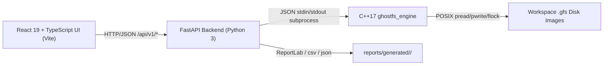

# GhostFS — Digital Forensics & Custom File System Recovery Engine

**GhostFS** is an educational Operating Systems and Digital Forensics workstation for creating, inspecting, corrupting, repairing, and recovering files from custom virtual disk images (`.gfs`). All operations execute through a real **C++17** engine—never simulated in the frontend—and never touch physical host disks.

---

## Core Features

1. **Virtual Disk Manager & GFS1 File System**: Configurable `.gfs` images (`512` / `1024` / `2048` / `4096` B blocks), POSIX `flock` locking, primary/backup superblocks, bitmaps, 128 B inodes (direct, single-indirect, double-indirect), metadata CRC32s, and dirty-journal crash detection.
2. **Block Allocation & Fragmentation Lab**: `First Fit`, `Best Fit`, `Worst Fit`, and `Bitmap Next Fit` operating on the live GFS1 block bitmap, with internal/external fragmentation analysis and 4-policy comparison.
3. **Forensic Recovery Engine**: Non-destructive metadata reconstruction + signature carving (PNG, JPEG, PDF, heuristic UTF-8 TXT), explicit `verified_bytes` / `unknown_candidate_bytes` / `missing_bytes` / `overwritten_bytes` / `substituted_bytes` manifests, and stale-scan SHA-256 checks.
4. **Read-Only Hex Viewer**: Block, byte-range, logical-file, and recovered-artifact inspection, LE/BE data interpretation, GFS1 structure decoding, chunked search, Shannon entropy, and binary diffing.
5. **Corruption & Repair Laboratory**: Workspace-confined sandbox cloning (`disk_images/sandbox/`), 10 deterministic corruption categories (A–J), independent read-only `gfsck`, dependency-ordered repair plans with dry-run & stale-plan rejection, `/lost+found` orphan recovery, and before/after comparison.
6. **Disk Scheduling & I/O Analysis (Simulator)**: Educational C++17 simulator for `FCFS`, `SSTF`, `SCAN`, `C-SCAN`, `LOOK`, and `C-LOOK` (static & dynamic modes), interactive SVG trajectory playback, and GFS1 file/recovery/allocation workload integration.
7. **Forensic Reports & Evidence Export**: ReportLab A4 PDFs, `allow_nan=False` JSON, formula-sanitized CSVs, and external SHA-256 artifact manifests (`reports/generated/<report_id>/`).

---

## System Architecture



---

## Quick Start

```bash
chmod +x start.sh
./start.sh
```

`./start.sh` automatically checks prerequisites (`clang++`/`g++`, `cmake`, `python3`, `node`, `npm`), creates the Python virtual environment, installs dependencies on first run, compiles the C++17 engine, starts FastAPI (`127.0.0.1:8000`) and Vite (`127.0.0.1:5173`), verifies `/api/v1/health`, and opens `http://127.0.0.1:5173` in your browser. Press `Ctrl+C` to stop both servers cleanly.

---

## Prerequisites & Launcher Commands

- **C++17 compiler** (`clang++` or `g++`), **CMake >= 3.20**
- **Python >= 3.11** (`venv`, `pip`)
- **Node.js >= 20** & `npm`

```bash
./start.sh                 # Auto-setup, build, start & wait (Ctrl+C stops)
./start.sh start           # Start in background (use --no-browser to skip opening browser)
./start.sh stop            # Stop GhostFS-owned processes
./start.sh restart         # Restart GhostFS-owned processes
./start.sh status          # Display engine, backend, and frontend status
./start.sh setup           # Install project-local Python & Node dependencies
./start.sh build           # Build C++17 engine and React frontend
./start.sh test            # Run C++ CTest, FastAPI Pytest, and Frontend build
./start.sh demo            # Run complete investigation demonstration
./start.sh sanitize asan   # Run AddressSanitizer / UndefinedBehaviorSanitizer (ubsan)
./start.sh logs            # Display backend & frontend logs
./start.sh help            # Show all commands and environment overrides
```

- **Playwright Browser E2E** (all 9 pages):
  ```bash
  RUN_E2E=1 ./start.sh test
  # Optional local browser override:
  PLAYWRIGHT_EXECUTABLE_PATH="/Applications/Google Chrome.app/Contents/MacOS/Google Chrome" RUN_E2E=1 ./start.sh test
  ```

---

## Repository Structure

```text
GhostFS/
├── engine/          # C++17 core engine, GFS1 format, allocator, recovery, hex, repair, scheduler, GoogleTest
├── backend/         # FastAPI routes, Pydantic schemas, subprocess runner, ReportLab PDF/JSON/CSV exporters, Pytest
├── frontend/        # React + TypeScript + Tailwind + Recharts UI, Playwright E2E tests
├── scripts/         # Portable setup, build, start, stop, test, demo, sanitize scripts
├── docs/            # Architecture, format specs, security, OS mapping, viva guide, curated screenshots
├── Dockerfile       # Ubuntu 24.04 Linux verification image
└── docker-compose.yml
```

---

## Screenshots

Curated screenshots of all 9 workstation pages are stored in [`docs/screenshots/`](docs/screenshots/):
- [Dashboard](docs/screenshots/01-dashboard.png) | [Disk Manager](docs/screenshots/02-disk-manager.png) | [File Explorer](docs/screenshots/03-file-explorer.png)
- [Block Explorer](docs/screenshots/04-block-explorer.png) | [Recovery Center](docs/screenshots/05-recovery-center.png) | [Hex Viewer](docs/screenshots/06-hex-viewer.png)
- [Corruption Lab](docs/screenshots/07-corruption-lab.png) | [Disk Scheduler](docs/screenshots/08-disk-scheduler.png) | [Forensic Reports](docs/screenshots/09-forensic-reports.png)

---

## Documentation Index

- [Architecture](docs/architecture.md)
- [GFS1 Binary Format](docs/gfs1-format.md)
- [Forensic Recovery](docs/forensic-recovery.md)
- [Hex Inspector](docs/hex-inspector.md)
- [Corruption & Repair Lab](docs/corruption-and-repair.md)
- [Disk Scheduling & I/O Analysis](docs/disk-scheduling.md)
- [Forensic Reporting](docs/reporting.md)
- [API Reference](docs/api-reference.md)
- [Security Model](docs/security-model.md)
- [Testing Guide](docs/testing.md)
- [Acceptance Checklist](docs/acceptance-checklist.md)
- [Demonstration Guide](docs/demo-guide.md)
- [OS Syllabus Mapping](docs/os-syllabus-mapping.md)
- [Academic Project Report](docs/project-report.md)
- [Viva Guide (50 Q&A)](docs/viva-guide.md)
- [Known Limitations](docs/known-limitations.md)
