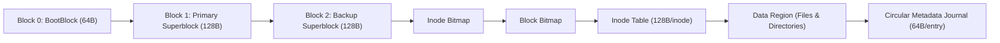

# GFS1 Binary File-System Format Specification

GFS1 is GhostFS's educational custom binary file-system format using fixed-width little-endian serialization (`engine/include/ghostfs/gfs_format.hpp`, `engine/src/filesystem/gfs_format.cpp`).

## Disk Layout

## Key Structures
- **Supported Block Sizes**: `512`, `1024`, `2048`, `4096` (default `4096`).
- **Superblock (`128` B)**: Magic `0x47465331` (`"GFS1"`), `version = 1`, geometry starts/counts, `alloc_policy`, `fs_state` (`Clean=1`, `Dirty=2`, `Corrupted=4`), `next_alloc_cursor`, `next_journal_seq`, IEEE CRC32.
- **Inode (`128` B)**: `inode_id`, `type`, `state` (`Free=0`, `Allocated=1`, `Deleted=2`), `size_bytes`, timestamps, `direct_blocks[12]`, `indirect_block`, `double_indirect_block`, `content_crc32`, `generation`, `inode_crc32`.
- **Directory Entry (`64` B)**: `inode_id`, `entry_type`, `state` (`Empty=0`, `Active=1`, `Deleted=2`), `name_len`, `name` (up to `55` bytes).
- **Journal Entry (`64` B)**: Lightweight metadata intent record (`seq_no`, `timestamp_ms`, `op_type`, `status`, `target_inode`, `target_block`, `summary`, `crc32`).
