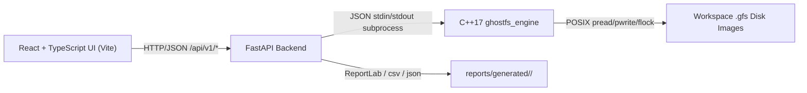

# GhostFS — Digital Forensics & Custom File System Recovery Engine
## Academic Project Report

> **Student / Institution Placeholders:** `[Student Name]`, `[Roll / Registration No.]`, `[Guide / Faculty Name]`, `[Department of Computer Science & Engineering]`, `[Institution Name]`, `[Academic Year]`

---

## 1. Abstract
GhostFS is an educational Operating Systems and Digital Forensics workstation implementing a custom binary file system (`GFS1`) in C++17, orchestrated by a Python FastAPI backend and visualized through a React + TypeScript workstation UI. The system demonstrates virtual disk management, direct/indirect inode addressing, four block allocation policies, internal/external fragmentation analysis, metadata- and signature-based deleted-file recovery, read-only hexadecimal inspection, sandboxed corruption injection and `gfsck` consistency repair, six disk scheduling algorithms, and reproducible ReportLab PDF/JSON/CSV forensic reporting.

## 2. Introduction & Problem Statement
Operating Systems students rarely get to inspect live on-disk metadata structures, observe unlinked residual data after deletion, inject controlled corruption safely, or connect file-system fragmentation directly to disk head scheduling. GhostFS bridges this gap using workspace-confined `.gfs` virtual disk images.

## 3. Objectives & Scope
- Implement a real C++17 binary file system (`GFS1`) with POSIX file locking and CRC32 integrity checks.
- Compare First Fit, Best Fit, Worst Fit, and Bitmap Next Fit allocation policies on identical workloads.
- Perform non-destructive deleted-file recovery and signature carving with explicit byte-level provenance.
- Provide a read-only hex inspector, sandboxed corruption/repair lab (`gfsck`), 6-algorithm disk scheduler, and verifiable PDF/JSON/CSV reports.

## 4. Technology Stack & System Architecture
- **Core Engine**: C++17, CMake, `nlohmann/json`, GoogleTest.
- **Backend**: Python 3, FastAPI, Pydantic, Uvicorn, ReportLab, `pypdf`.
- **Frontend**: React 19, TypeScript, Vite, Tailwind CSS, Recharts, Lucide Icons, Playwright.

## 5. GFS1 File System & Algorithms
- **GFS1 Layout**: BootBlock (0), Primary/Backup Superblocks (1–2), Inode Bitmap, Block Bitmap, Inode Table (128 B/inode, 12 direct + single/double indirect), Data Region, Circular Journal (64 B/entry).
- **Allocation**: First Fit, Best Fit, Worst Fit, Bitmap Next Fit with fragmented fallback.
- **Recovery**: Metadata inode/block reconstruction + signature carving (PNG, JPEG, PDF, heuristic TXT).
- **GFSCK & Repair**: Geometry/superblock validation, ownership map, cycle-safe BFS directory traversal, conservative journal reconstruction, `/lost+found` orphan reconnection.
- **Disk Scheduling**: `FCFS`, `SSTF`, `SCAN`, `C-SCAN`, `LOOK`, `C-LOOK` (static baseline + dynamic arrival-time mode).

## 6. Testing Methodology & Actual Results
- **C++17 GoogleTest (`ctest`)**: `45/45` tests passed across Phases 1–9 (including textbook totals `FCFS=640`, `SSTF=236`, `SCAN=331`, `C-SCAN=382`, `LOOK=299`, `C-LOOK=322`, and Phase 9 adversarial malformed-input tests).
- **FastAPI Pytest**: `12/12` integration tests passed (including `pypdf` PDF parsing, CSV injection protection, and artifact tamper detection).
- **Playwright E2E**: Browser workflows verified across all 9 pages.

## 7. Security, Limitations & Future Scope
- Workspace path confinement, symlink rejection, POSIX `flock`, CSV formula sanitization, XML escaping in ReportLab, and localhost-only binding.
- Limitations: Educational simulator (not a kernel VFS or host OS I/O scheduler); 64-byte intent journal supports conservative reconstruction rather than full WAL replay.
- Future scope: Full physical undo/redo WAL logging, multi-disk RAID educational simulation, and native x86-64 CI matrix.

## 8. Conclusion
GhostFS successfully unifies core Operating Systems concepts—storage layout, allocation, crash detection, recovery, I/O scheduling, and verifiable forensic reporting—into a single reproducible, evidence-backed workstation.
